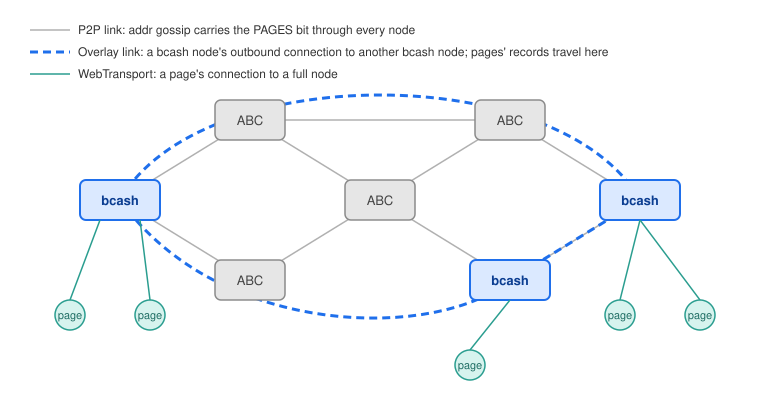
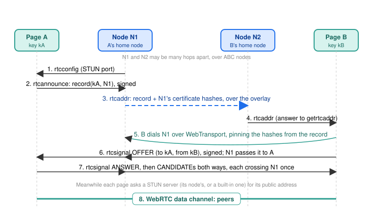
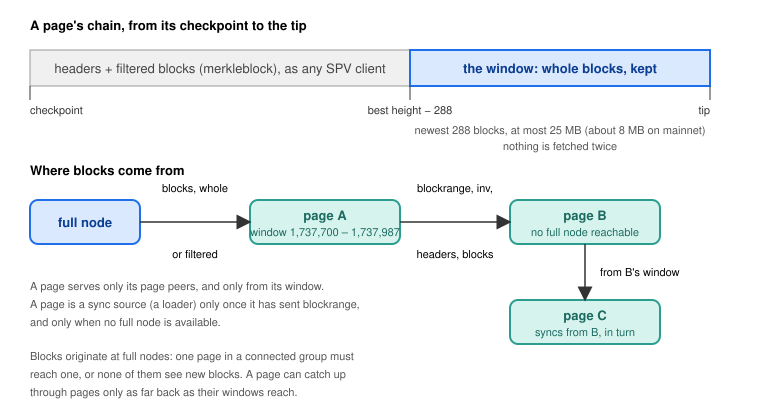
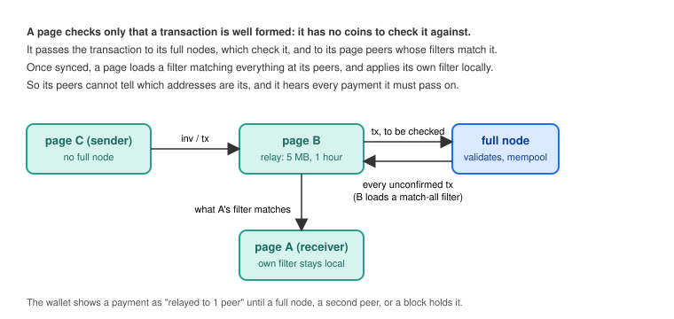

# SPV+ Protocol Suite Specification
### Specification version: 0.1
### Date published: October 31, 2026

## Authors
Vin Armani

## Acknowledgements
The bcoin and bcash contributors, whose SPV node this suite extends

Bitcoin ABC, whose nodes carry the suite's discovery without knowing it

# Table of Contents
[SECTION I: BACKGROUND](#section-i-background) 
&nbsp;&nbsp;&nbsp;&nbsp;[Introduction](#introduction) 
&nbsp;&nbsp;&nbsp;&nbsp;[Summary](#summary) 
&nbsp;&nbsp;&nbsp;&nbsp;[Requirements](#requirements) 
&nbsp;&nbsp;&nbsp;&nbsp;[Design Philosophy](#design-philosophy) 
&nbsp;&nbsp;&nbsp;&nbsp;&nbsp;&nbsp;&nbsp;&nbsp;[The full node is the only infrastructure](#the-full-node-is-the-only-infrastructure) 
&nbsp;&nbsp;&nbsp;&nbsp;&nbsp;&nbsp;&nbsp;&nbsp;[Nothing new to trust](#nothing-new-to-trust) 
&nbsp;&nbsp;&nbsp;&nbsp;&nbsp;&nbsp;&nbsp;&nbsp;[Invisible to other implementations](#invisible-to-other-implementations) 
&nbsp;&nbsp;&nbsp;&nbsp;&nbsp;&nbsp;&nbsp;&nbsp;[Measured, not guessed](#measured-not-guessed) 

[SECTION II: PROTOCOL DESCRIPTION](#section-ii-protocol-description) 
&nbsp;&nbsp;&nbsp;&nbsp;[Protocol Overview](#protocol-overview) 
&nbsp;&nbsp;&nbsp;&nbsp;[Transport: WebTransport](#transport-webtransport) 
&nbsp;&nbsp;&nbsp;&nbsp;&nbsp;&nbsp;&nbsp;&nbsp;[Certificates](#certificates) 
&nbsp;&nbsp;&nbsp;&nbsp;&nbsp;&nbsp;&nbsp;&nbsp;[Seeds](#seeds) 
&nbsp;&nbsp;&nbsp;&nbsp;&nbsp;&nbsp;&nbsp;&nbsp;[Where a page's chain starts](#where-a-pages-chain-starts) 
&nbsp;&nbsp;&nbsp;&nbsp;&nbsp;&nbsp;&nbsp;&nbsp;[Connection slots](#connection-slots) 
&nbsp;&nbsp;&nbsp;&nbsp;[Discovery: the bcash overlay](#discovery-the-bcash-overlay) 
&nbsp;&nbsp;&nbsp;&nbsp;&nbsp;&nbsp;&nbsp;&nbsp;[The PAGES service bit](#the-pages-service-bit) 
&nbsp;&nbsp;&nbsp;&nbsp;&nbsp;&nbsp;&nbsp;&nbsp;[Building the overlay](#building-the-overlay) 
&nbsp;&nbsp;&nbsp;&nbsp;&nbsp;&nbsp;&nbsp;&nbsp;[Page records](#page-records) 
&nbsp;&nbsp;&nbsp;&nbsp;[Introductions: WebRTC](#introductions-webrtc) 
&nbsp;&nbsp;&nbsp;&nbsp;&nbsp;&nbsp;&nbsp;&nbsp;[STUN at the full node](#stun-at-the-full-node) 
&nbsp;&nbsp;&nbsp;&nbsp;&nbsp;&nbsp;&nbsp;&nbsp;[Signalling through the home node](#signalling-through-the-home-node) 
&nbsp;&nbsp;&nbsp;&nbsp;&nbsp;&nbsp;&nbsp;&nbsp;[Pages introducing pages](#pages-introducing-pages) 
&nbsp;&nbsp;&nbsp;&nbsp;&nbsp;&nbsp;&nbsp;&nbsp;[A page as a peer](#a-page-as-a-peer) 
&nbsp;&nbsp;&nbsp;&nbsp;[Syncing: the block window](#syncing-the-block-window) 
&nbsp;&nbsp;&nbsp;&nbsp;&nbsp;&nbsp;&nbsp;&nbsp;[Filling the window](#filling-the-window) 
&nbsp;&nbsp;&nbsp;&nbsp;&nbsp;&nbsp;&nbsp;&nbsp;[Serving the window](#serving-the-window) 
&nbsp;&nbsp;&nbsp;&nbsp;&nbsp;&nbsp;&nbsp;&nbsp;[Syncing from a page](#syncing-from-a-page) 
&nbsp;&nbsp;&nbsp;&nbsp;[Relaying: unconfirmed transactions](#relaying-unconfirmed-transactions) 
&nbsp;&nbsp;&nbsp;&nbsp;[Message Detail](#message-detail) 
&nbsp;&nbsp;&nbsp;&nbsp;&nbsp;&nbsp;&nbsp;&nbsp;[Formatting](#formatting) 
&nbsp;&nbsp;&nbsp;&nbsp;&nbsp;&nbsp;&nbsp;&nbsp;[wtaddr and getwtaddr](#wtaddr-and-getwtaddr) 
&nbsp;&nbsp;&nbsp;&nbsp;&nbsp;&nbsp;&nbsp;&nbsp;[rtcconfig](#rtcconfig) 
&nbsp;&nbsp;&nbsp;&nbsp;&nbsp;&nbsp;&nbsp;&nbsp;[rtcannounce, rtcaddr and getrtcaddr](#rtcannounce-rtcaddr-and-getrtcaddr) 
&nbsp;&nbsp;&nbsp;&nbsp;&nbsp;&nbsp;&nbsp;&nbsp;[rtcsignal](#rtcsignal) 
&nbsp;&nbsp;&nbsp;&nbsp;&nbsp;&nbsp;&nbsp;&nbsp;[blockrange](#blockrange) 
&nbsp;&nbsp;&nbsp;&nbsp;[Parameters](#parameters) 

[SECTION III: FURTHER ANALYSIS](#section-iii-further-analysis) 
&nbsp;&nbsp;&nbsp;&nbsp;[Security Model](#security-model) 
&nbsp;&nbsp;&nbsp;&nbsp;[Wallet Implementation](#wallet-implementation) 
&nbsp;&nbsp;&nbsp;&nbsp;[Running a Node for Pages](#running-a-node-for-pages) 
&nbsp;&nbsp;&nbsp;&nbsp;[Limitations](#limitations) 
&nbsp;&nbsp;&nbsp;&nbsp;[Economic Implications](#economic-implications) 

[Copyright](#copyright)

# SECTION I: BACKGROUND

## Introduction

Simplified Payment Verification, as Satoshi Nakamoto described it, lets a
client confirm its own payments with block headers and Merkle proofs alone.
It has always had a cost that the description leaves out: an SPV client is a
leech. It takes a connection slot at a full node, asks for filtered blocks,
and gives nothing back. It cannot serve another client, because it holds no
blocks. It cannot pass a transaction on, because it holds no mempool to
check one against. When its full node goes away, it is simply offline.

As eCash applications move into the browser, where a page is a complete SPV
node, this cost multiplies. Every open tab is another leech, and a popular
application could occupy every inbound slot the network's full nodes have,
while contributing no capacity of its own.

SPV+ ("SPV Plus") is the set of additions to bcash's SPV node that turns a
light client into a participant. A page running SPV+ connects to full nodes
over WebTransport, finds other pages through those nodes, connects to them
directly over WebRTC, and from then on serves them: the newest blocks,
whole or filtered for them; unconfirmed transactions, both ways; and
introductions to yet more pages. A group of such pages stays synced through
one another when only one of them can reach a full node, and keeps
relaying payments when none of them can.

## Summary

SPV+ is four pieces, each of which is small on its own and which fit
together into one system:

1. **WebTransport** carries the existing P2P protocol into the browser.
   A full node serves it over UDP with a self-signed certificate that pages
   pin by its hash, so any node with a public IP address can serve pages
   without a domain name or a certificate authority.
2. **Discovery** uses a service bit, `PAGES`, that travels through ordinary
   address gossip across every node on the network, including nodes that
   know nothing of SPV+. bcash nodes use it to find one another and keep a
   few connections among themselves: an overlay on which pages' records
   travel.
3. **Introductions** let two pages whose nodes are far apart connect over
   WebRTC. Each page announces a signed record at its home node; the record
   spreads over the overlay; a page that hears of it dials the home node and
   sends its WebRTC offer through it. Full nodes also answer STUN, so a
   page behind a home router can learn its own address with no third party.
4. **Syncing and relaying** make a page useful to its page peers. A page
   keeps its newest blocks whole, in a bounded window, and serves them; it
   keeps unconfirmed transactions for a bounded time and passes them on.

None of this changes consensus, the block format, or the transaction
format. Every new message is an ordinary P2P message with a new command
name, which other implementations ignore.

## Requirements

We hold that a system for light clients to contribute to the network must
have these properties:

**1. Serverless.** A page must need nothing but full nodes: no signalling
server, no proxy, no indexer, no third-party STUN or TURN service.\
**2. Non-invasive.** It must require no change to consensus, and must not
disturb nodes that do not implement it.\
**3. Discoverable across the whole network.** Two pages must find each
other when their full nodes are connected only through nodes that do not
implement SPV+, however many hops apart.\
**4. No new trust.** A page must accept nothing from another page that it
would not check if it came from a full node.\
**5. Bounded.** Everything a page keeps for others must have a limit the
browser can afford, in storage and in time.\
**6. Useful alone.** A page cut off from every full node must stay synced
through its page peers, and its payments must still reach a full node
through them.\
**7. Default on.** The web wallet ships with all of it enabled, because a
feature light clients must opt into is one most of them never use.

## Design Philosophy

### The full node is the only infrastructure

Every design for connecting browsers to one another leans on something in
the middle: a signalling server, a STUN or TURN service, a tracker. Each one
is an operator who can go away, log, or be compelled. We chose to lean on
the one piece of infrastructure the network already has and already pays
for, the full node, and to add to it only what a full node is naturally
placed to do.

A full node that serves pages is already reachable on a public UDP port,
so it answers STUN there as well: a reflexive-address service is a few
dozen lines and a few bytes per answer. A full node already knows the pages
connected to it, so it introduces them: passing a signed offer from one
page to another is no different in kind from passing an `addr`. A full
node already gossips addresses with every other node, so a service bit in
that gossip is enough to find the other bcash nodes. There is no new
service to run, and therefore nothing new to depend on.

This also sets the model for applications. A DApp whose pages run SPV+
needs a full node for its pages to be introduced through. The DApp's
creator is the natural party to run that node, and is thereby led to add
to the network's capacity rather than to consume it. A relay server would
have been simpler to write, and would have led them the other way.

### Nothing new to trust

A page already trusts nothing it is told: headers must carry proof of work,
transactions must be proven in a block, and a peer that sends an invalid
block is banned. SPV+ keeps to that. A page serving blocks to another page
can give it nothing a full node could not have given it, and the receiver
checks it the same way. A node introducing two pages sees their offer and
answer, and could in principle put itself between them; it would gain the
power of a peer, which is no power at all. Every record and signal is
signed by the page it speaks for, so no node and no page can announce,
offer, or answer for another.

Where a page genuinely cannot check something, the suite does not pretend
it can. A page has no coins and so cannot validate a transaction; it checks
only that one is well formed and passes it to a full node, which checks the
rest. The wallet tells the user exactly that: a payment that has reached
only one other page is "relayed to 1 peer", not sent.

### Invisible to other implementations

eCash's network is mostly Bitcoin ABC nodes, which must carry SPV+ without
being changed and without being bothered. The suite therefore uses only
two things every node already does: it relays `addr` entries with their
service bits unchanged, whatever the bits mean; and it ignores messages
whose command it does not know, without penalty. Everything SPV+ adds is
either a service bit or an unknown message. Nothing it adds is sent to a
node that has not shown, by its service bits and its user agent, that it
understands it.

### Measured, not guessed

Where a parameter could be chosen by argument or by measurement, we
measured. The size of the block window, the order in which a page fetches
whole and filtered blocks, and the number of overlay connections were each
set after timing the alternatives on mainnet, and the figures are given in
the sections that follow so they can be checked.

# SECTION II: PROTOCOL DESCRIPTION

## Protocol Overview

A page's life under SPV+ runs as follows.

1. It dials a seed by its domain name, asks which WebTransport nodes the
   seed knows, and disconnects. On later visits it dials nodes it remembers
   and needs no seed.
2. It dials nodes by their IP addresses, pinning each one's self-signed
   certificate by hash, and syncs headers from the newest checkpoint built
   into bcash.
3. The first node that tells it `rtcconfig` becomes its home node. The page
   signs a record naming its key and that node, announces it, and asks for
   the records the node knows. The node passes the record to the other
   bcash nodes it is connected to, which pass it on, so it reaches every
   bcash node on the network.
4. The page dials other pages from the records it receives: through each
   one's home node, with signed WebRTC signals, after asking a STUN server
   for its own public address. Connected pages exchange records and
   introduce one another to their other page peers.
5. While syncing, the page fetches blocks within 288 of the best known
   height whole and keeps them; older blocks it fetches filtered, as before.
   It tells its page peers the range it holds and serves them blocks,
   headers, and filtered blocks from it.
6. Once synced, it asks its peers for every unconfirmed transaction, keeps
   them briefly, and passes them to the page peers whose filters match and
   to its full nodes.
7. If it loses every full node, it syncs from a page peer that holds blocks,
   and its payments reach a full node through its page peers.

## Transport: WebTransport

Browsers cannot open TCP sockets, so a page cannot speak the P2P protocol
as a node does. The two transports browsers do offer are WebSocket and
WebTransport. We chose WebTransport, and the reason is certificates.

A WebSocket must be secure (`wss:`) on a secure page, and a secure
WebSocket requires a certificate the browser's authorities vouch for. That
means every node serving pages would need a domain name, a certificate
issued for it, and the renewal of that certificate: an operator's burden
that most node runners would not take on, leaving pages dependent on the
few that did. WebTransport, which runs over HTTP/3 on UDP, allows a page to
accept a server's certificate by its SHA-256 hash instead
(`serverCertificateHashes`). A node can then make its own certificate, and
any node with a public IP address and an open UDP port can serve pages.
That property, more than any throughput figure, is what makes a network of
page-serving nodes possible.

A node started with `--wt-port` listens for WebTransport sessions at the
path `/p2p`. One bidirectional stream carries exactly the bytes a TCP
socket would, so the peer and pool code see a socket like any other, and
the P2P protocol is unchanged above the transport.

### Certificates

Browsers accept a pinned certificate only if it uses an ECDSA P-256 key and
is valid for less than 14 days. A node therefore makes a certificate valid
for 13 days, dated from an hour earlier for clocks a little behind, and
makes the next one when the current has two days left. It announces both,
current then next, so pages that pinned the current hash learn the next a
day before the switch and are never cut off by rotation.

Nodes tell one another their WebTransport endpoints in `wtaddr` messages:
address, services, WebTransport port, and up to four certificate hashes
with their expiry times. A node sends its own endpoint on every handshake,
and answers `getwtaddr` with the endpoints it knows, its own first. A page
keeps the endpoints it learns in `localStorage`, so after its first visit
it dials nodes directly.

### Seeds

A page's very first connection has no hash to pin, so it must trust a
certificate the ordinary way. A seed is a WebTransport node that also
serves, on a second UDP port, a certificate for a domain name, such as one
from Let's Encrypt. Each network lists its seeds in `lib/protocol/networks.js`
(`wtSeeds`), as it lists DNS seeds for TCP nodes. The page asks a seed for
the nodes it knows and disconnects; the seed's work is done in one round
trip, and from then on the page relies on pinned nodes. The seed reloads
its certificate files hourly, so renewal needs no restart.

### Where a page's chain starts

A page does not download the chain. It starts at the newest checkpoint
built into bcash and downloads headers from there, once per browser, into
IndexedDB. A page cannot safely start from "the tip" a peer reports, since
a peer could report a false one; the checkpoint is the one thing the page
knows before it talks to anyone, and every header after it is checked
against the one before. Starting from a checkpoint is what makes the rest
of the suite safe: everything a page later accepts from a page peer is
checked against a chain of headers that no page peer gave it.

### Connection slots

Pages are counted apart from TCP peers at a full node: `wt-max-inbound`
(default 64) beside `max-inbound` (default 8). A busy TCP node never turns
pages away, and pages never crowd out nodes. This is the first half of the
answer to the leech problem, the half that keeps pages from exhausting the
network; the rest of the suite is the half that has pages add capacity.

## Discovery: the bcash overlay

For two pages to be introduced, the record one of them announces must reach
the node the other is connected to. Those two nodes may be anywhere on the
network, connected only through Bitcoin ABC nodes, which will not pass a
record on. The suite's answer is an overlay: a few connections among bcash
nodes themselves, found by a means that does cross ABC nodes.

### The PAGES service bit

A node that passes pages' records on and introduces pages advertises
service bit 27, `PAGES` (`1 << 27`), in its `version` message and in the
`addr` entries that carry its address. Bit 27 is in the range 24–31 that
Bitcoin ABC treats as experimental, and ABC relays `addr` entries with
their service bits unchanged whatever the bits mean. So a bcash node's
address, with its bit, reaches every node on the network through the
ordinary gossip that every implementation performs. This is the one part
of SPV+ that crosses nodes which do not implement it, and it is enough:
once bcash nodes can find each other, everything else travels between them
directly.

A service bit is a claim, not a proof. Bits in the experimental range may
be used by other software for other purposes, so a node does not take the
bit alone as meaning a peer passes records on. It requires `PAGES` and
`NETWORK` in the peer's services and a user agent beginning `/bcash:` from
the peer's `version` message before it treats the peer as part of the
overlay (`isRTCRelay`). Records are sent only to such peers.

### Building the overlay

Every bcash full node keeps two of its outbound connections
(`PAGES_OUTBOUND`) to nodes whose addresses carry the bit. When it has
fewer, it picks at random a known address with `NETWORK` and `PAGES` that
it has not tried in ten minutes and is not banned, and dials it. A node
behind a home router cannot be dialed, but it can dial out, so it joins
the overlay too; only nodes that accept connections spread their addresses.

Two was chosen as the smallest number that makes the overlay connected in
practice. Each node's two outbound links, plus the inbound links other
nodes make to it, give a random graph with an average degree of four or
more, which is connected with high probability and in which a record
reaches every node in a few hops. Using more slots would take connections
from the general network, which a full node needs for blocks and
transactions, for no gain pages would notice: a record has twenty minutes
to arrive.

On the handshake with a new overlay peer, a node sends it the records it
holds, up to 100 in one message. From then on each new record a node learns
goes to every overlay peer but the one it came from. A node keeps at most
1000 records, and a record expires twenty minutes after its time.

### Page records

A record says: this key accepts WebRTC connections, and can be reached
through this node. It holds the page's public key (33 bytes, secp256k1
compressed), the time, and the home node's address and port, signed by the
page's key; then the home node's certificate hashes, which the node adds.

The node adds the hashes rather than the page, for two reasons. The node's
current and next certificates are authoritative, where a page knows only
the hash it happened to dial with. And a node adds hashes only to a record
that names itself, received from a page connected to it; so a record can
never name a node its page is not at, and a dialer can trust that the home
node named is one the page really reached.

A page's key is made once per node instance and is not its wallet key: it
identifies the page as a peer and nothing else. In the peer list a page is
given a synthetic address derived from its key, in the unique-local IPv6
range `fd00::/8`, which no one can dial. That keeps every structure that
is keyed by address, such as the peer list and ban list, unchanged.

A page renews its record every ten minutes, half its lifetime, at its home
node. If its home node drops, it announces at the next node that has told
it `rtcconfig`. Only records whose home address is routable are passed on
(except on regtest), since a record no one can act on is noise.

## Introductions: WebRTC

Two pages cannot dial each other: neither has an address anyone can reach.
WebRTC solves this with ICE, which needs two things from outside: a way for
each page to learn its public address (STUN), and a way to carry each
page's offer, answer, and candidates to the other (signalling). SPV+ gets
both from full nodes.

### STUN at the full node

A page behind a home router does not know the address its traffic leaves
from. A STUN server tells it: the page sends a Binding request, and the
server answers with the address and port it saw. A node that serves pages
is already listening on a public UDP port, so it answers STUN as well, on
`--stun-port`. The implementation is RFC 8489's Binding method only, with
`XOR-MAPPED-ADDRESS`, `FINGERPRINT`, and the error responses the RFC
requires, and nothing else: no authentication, no TURN, no relaying.

Each answer is a few bytes longer than its request, and the server answers
one address at most ten times in a burst and five times a second after
that, tracking at most 10,000 addresses. Those limits are the whole of the
server's defence against use as a traffic reflector, and they are
sufficient because the amplification is nearly nil.

A node tells a page its STUN port in `rtcconfig`; `0` means none. A page
remembers up to eight STUN servers from its nodes and uses the two newest
when it makes a connection. Because STUN needs no connection to the node,
a page that has lost all its nodes still has its STUN servers.

A page whose nodes run no STUN would be unable to connect to pages
elsewhere, so each network lists two STUN servers built into bcash
(`stunServers`: `ecash.badger.cash:3478` and `webnode.badger.cash:3478`),
and a page adds from that list until it has two. STUN knows no chain, so
mainnet and testnet share the list. This fallback is the one place the
suite names fixed hosts other than seeds, and it is only a fallback: a
node's own STUN comes first.

### Signalling through the home node

A page that wants to connect to a page it has a record for:

1. dials the record's home node over WebTransport, pinning the hashes in
   the record, if it is not connected to that node already;
2. sends an `rtcsignal` to the node, addressed to the other page's key,
   carrying its WebRTC offer, signed by its own key;
3. receives the answer and ICE candidates the same way, and sends its own.

The node passes each signal to the page whose key it is addressed to, if
that page is connected to it, and otherwise drops it. Every signal crosses
exactly one node, however far apart the two pages' home nodes are: the
dialer goes to the other page's node, rather than the signal being routed
across the overlay. This keeps signalling simple, fast, and unforgeable
with no routing state at any node. A signal is one of OFFER, ANSWER, or
CANDIDATE, carries at most 8 KB, and is accepted only within five minutes
of its time.

Signalling through a node rather than on the chain was a deliberate
choice. An on-chain signal (as in the SLP Session Description Protocol)
costs a transaction and a block's latency per message, and an ICE exchange
is several messages. A node passes a signal in milliseconds for nothing,
and the node is already the thing a page is talking to. What the node
learns is what any signalling server learns, the offer and answer, and
what it could do with that is limited to the power of a peer, as the
security model below describes.

The data channel, once open, is encrypted end to end (WebRTC's DTLS), so
the introducing node cannot read it.

### Pages introducing pages

A page that has met one page can meet more through it, without a node.
When a data channel opens, each page sends the other its record, with no
home node (host `0.0.0.0`), and asks `getrtcaddr`. A page answers with the
records of its other page peers, at most once in ten seconds, and passes
an `rtcsignal` on to the page peer it is addressed to, one hop, as a node
does. So a page that has lost every full node can still meet new pages
through the ones it knows, and each new link brings it more.

A page still needs some reachable go-between on each visit to be
introduced at all, since a page cannot be dialed and STUN only tells a
page its own address. That go-between is a full node. This is by design:
the suite reduces what pages take from full nodes and adds what pages give
to one another, but it does not pretend pages can bootstrap from nothing.

### A page as a peer

A page keeps at most four WebRTC peers (`rtcMaxPeers`), counted apart from
its connections to full nodes, so page peers never displace nodes. It
looks for more every 15 seconds while below that, gives a dial 30 seconds,
and retries a page no sooner than five minutes after a failure. The data
channel carries messages in chunks of 16 KB, with back pressure above 1 MB
queued.

A page peer is never chosen as the peer to sync from unless it has sent a
`blockrange`, and never while a full node is available. Everything a page
peer sends is checked as a full node's would be, and a page peer that
sends an invalid block is banned like a node.

## Syncing: the block window

An SPV node keeps no blocks, only what its filter matched. A page that is
to serve other pages must keep some blocks whole. The question is which,
and how many.

A page keeps the newest 288 blocks of its chain, about two days, and at
most 25 MB of them, whichever is fewer (`windowBlocks`, `windowBytes`).
The number follows BIP 159's `NODE_NETWORK_LIMITED`, which chose 288 as
the range a pruned node serves and which the network's software already
knows how to use. The byte limit exists because the number alone is not a
bound a browser can rely on: blocks vary in size by orders of magnitude,
and a browser's storage is quota-limited and shared. On mainnet, 288
blocks is about 8 MB today, so the byte limit does not bind; it is there
for the day it does. Windowing by space rather than by count was
considered and rejected as the primary rule because a count is what BIP
159 peers expect, and because a page's usefulness to its peers is measured
in blocks, not bytes.

The window is stored in the page's chain database (IndexedDB), so a page
serves it again as soon as it is reopened, and refills what it missed
while closed, newest first.

### Filling the window

A page could fetch every block whole and filter them itself; it could
fetch every block filtered and then fetch the newest again whole; or it
could fetch whole exactly the blocks it will keep and filtered the rest.
We measured the first and third on mainnet over WebTransport, syncing two
weeks of blocks:

| Method | Time | Downloaded |
|---|---|---|
| Filtered blocks only (plain SPV) | 6.4 s | 0.39 MB |
| Window rule: whole within 288 of the best height, filtered before | 8.1–8.5 s | 9.07 MB |
| Every block whole | 11–23 s | 25.7 MB |

The window rule costs a page two seconds and the window it ends up
holding, and nothing is downloaded twice. The second method would download
the window twice. The third costs more than twice the time for blocks the
page would discard. The rule is implemented as a height test when a page
asks for blocks: a block within 288 of the best height it knows is asked
for whole, and any other filtered. The best height is the greatest of the
page's own chain, its header chain, the heights its full nodes reported in
their `version` messages, and the top of any `blockrange` a page peer sent.

A block fetched whole is verified, then kept only if the page's chain has
that block at that height on its main chain. A page therefore never holds
a block it has not already accepted the header of, and a page peer cannot
feed it blocks from a chain it does not follow.

### Serving the window

A page with a window answers its page peers' `getheaders`, `getdata` for
blocks, and `getdata` for filtered blocks, from the headers and window it
holds, filtering a block for a peer with the peer's own Bloom filter as a
full node would. When it keeps a new block it tells its page peers with an
`inv`, then sends them its `blockrange`: the lowest and highest heights it
holds whole.

An SPV node is ordinarily selfish: it serves no one. The suite makes one
exception: a page with a window serves its page peers, and only them. It
does not serve full nodes, which have no use for it, and a page without a
window (one with `windowBytes` set to 0) serves no one, as before.

### Syncing from a page

A page that has no full node to sync from syncs from a page peer that has
sent a `blockrange`. It asks it for headers and blocks as it would a node,
fetches the blocks within the peer's range whole, and keeps them in its
own window, so it can in turn serve its own page peers. A page can thus
catch up through pages only as far back as their windows reach: a page
closed for a week must find a full node, as it would have anyway.

Blocks originate at full nodes. In any group of connected pages, at least
one must reach a full node, or none of them see new blocks. The suite does
not change where blocks come from; it changes how far they spread.

## Relaying: unconfirmed transactions

A page has no mempool: it holds no coins, so it cannot check whether a
transaction's inputs exist or are unspent. It can still pass transactions
on, and the suite has it do so, because a page cut off from full nodes
must still be able to pay and be paid.

Once synced, a page asks its full nodes and page peers for every
unconfirmed transaction, by loading a Bloom filter that matches anything
(8 bytes of `0xff`, one hash function), and keeps the transactions it
receives: at most 5 MB of them, each for an hour, or until a block confirms
it. It checks only that a transaction is well formed, and relays each one
it has not seen before to its page peers whose filters match it and to its
full nodes, which check the rest. So a page with no full node still hears
of payments to it, through a page that has one; and its own payments still
reach a full node, through another page.

The match-all filter has a second effect that was a reason in itself. A
page's own filter, the one that names its addresses, is now applied
locally and never sent to a peer once the page is synced. Its peers see a
filter that matches everything, and cannot tell which addresses are its.
Plain SPV gives that away to every node it connects to. While catching up,
a page still loads its own filter, because fetching two weeks of blocks
whole for the sake of privacy during sync would cost what the table above
shows.

A page cannot know whether a transaction it relays is valid, and the
wallet does not pretend otherwise: see [Wallet Implementation](#wallet-implementation).

## Message Detail

### Formatting

Every SPV+ message is an ordinary P2P message: the network magic, a
12-byte command, a length, a checksum, and a payload. Implementations that
do not know a command ignore the message. Integers are little endian
unless stated. Keys are 33-byte compressed secp256k1 public keys;
signatures are 64-byte ECDSA signatures over the SHA-256 of a tagged
preimage, as given for each message. Times are seconds since the Unix
epoch, as `u32`. Addresses are 16-byte IPv6, with IPv4 mapped.

### wtaddr and getwtaddr

`getwtaddr` has an empty payload and asks for the WebTransport endpoints
the peer knows. `wtaddr` carries them, at most 1000:

| Field | Size | Description |
|---|---|---|
| count | varint | number of entries |
| per entry: services | 8 | as in `addr` |
| ip | 16 | the node's address |
| port | 2, big endian | the WebTransport port, as `addr` encodes ports |
| hash count | 1 | 1 to 4 |
| per hash: hash | 32 | SHA-256 of the certificate's DER |
| not after | 4 | when the certificate expires |

A node sends its own endpoint on every handshake, and `getwtaddr` when it
is itself a WebTransport client. A node answers `getwtaddr` once per
connection, its own endpoint first, unless it is selfish.

### rtcconfig

Sent by a full node to a page on the handshake, if the node has a
WebTransport endpoint of its own: the node introduces pages.

| Field | Size | Description |
|---|---|---|
| stun port | 2 | the node's STUN port, or 0 for none |

### rtcannounce, rtcaddr and getrtcaddr

A **record** is:

| Field | Size | Description |
|---|---|---|
| key | 33 | the page's key |
| time | 4 | when the page made the record |
| host | 16 | the home node's address; `0.0.0.0` page to page |
| port | 2 | the home node's WebTransport port |
| signature | 64 | by `key`, over SHA-256(`"bcash rtc record"` ‖ key ‖ time ‖ host ‖ port) |
| hash count | 1 | 0 to 3; 0 from a page, filled in by the node |
| per hash: hash | 32 | the home node's certificate hash |
| not after | 4 | when it expires |

`rtcannounce` carries one record, from a page to its home node (which
checks the record names itself, adds its hashes, and passes it on), or
page to page on a data channel (with no home node, to say who the page
is).

`getrtcaddr` has an empty payload. `rtcaddr` answers it, and carries new
records between overlay nodes:

| Field | Size | Description |
|---|---|---|
| count | 1 | 0 to 100 |
| records | | as above |

A node answers a page's `getrtcaddr` with the records it knows but the
page's own, at most once in ten seconds; a page answers a page peer's with
the records of its other page peers, at the same rate. A record is
accepted only if it verifies, is fresh (its time at most twenty minutes
past and not more than ten minutes ahead), and, at a node, names a
routable home address and carries at least one hash.

### rtcsignal

| Field | Size | Description |
|---|---|---|
| to | 33 | the key the signal is for |
| from | 33 | the sender's key |
| time | 4 | when it was made |
| kind | 1 | 1 OFFER, 2 ANSWER, 3 CANDIDATE |
| data | varbytes | the SDP or ICE candidate, JSON, at most 8192 bytes |
| signature | 64 | by `from`, over SHA-256(`"bcash rtc signal"` ‖ to ‖ from ‖ time ‖ kind ‖ data) |

A node or page passes a signal to the connected page whose key is `to`,
and to no one else; one that is older than five minutes, does not verify,
or is addressed to no one connected is dropped. A page accepts a signal
only if `from` is the key the session was opened with.

### blockrange

Sent by a page to a page peer: the blocks it holds whole.

| Field | Size | Description |
|---|---|---|
| low | 4, signed | the lowest height held |
| high | 4, signed | the highest height held; −1 for none |

Sent after the handshake with each page peer and after each new block is
kept. A page with no peer to sync from begins syncing from the first page
peer whose `blockrange` has a height.

## Parameters

| Parameter | Value | Where |
|---|---|---|
| `PAGES` service bit | `1 << 27` | `lib/net/common.js` |
| Overlay connections kept per node | 2 | `Pool.PAGES_OUTBOUND` |
| Records kept per node; per `rtcaddr` | 1000; 100 | `lib/net/rtc.js` |
| Record lifetime; renewal | 20 min; 10 min | `lib/net/rtc.js` |
| Certificate hashes per record | 3 | `lib/net/rtc.js` |
| Signal size; age | 8192 bytes; 5 min | `lib/net/rtc.js` |
| STUN servers kept; used | 8; 2 | `lib/net/rtc.js` |
| STUN rate per address | 10 burst, 5/s | `lib/net/stun.js` |
| Page peers per page | 4 (`rtcMaxPeers`) | `lib/net/pool.js` |
| Window | 288 blocks, 25 MB | `lib/net/blockwindow.js` |
| Relay | 5 MB, 1 hour | `lib/net/txrelay.js` |
| Certificate validity; renewal | 13 days; at 2 days left | `lib/net/webtransport.js` |
| `wtaddr` entries; hashes per entry | 1000; 4 | `lib/net/webtransport.js` |
| Inbound pages per node | 64 (`wt-max-inbound`) | `lib/net/pool.js` |
| Fallback STUN | `ecash.badger.cash:3478`, `webnode.badger.cash:3478` | `lib/protocol/networks.js` |

# SECTION III: FURTHER ANALYSIS

## Security Model

**What a page accepts from a page.** Exactly what it would accept from a
full node, checked the same way: headers by their proof of work and
linkage to the checkpoint; blocks by their header and Merkle root, and by
being the block the page's own chain has at that height; transactions by
their proof in a block, as before. A page peer that sends an invalid block
is banned (100 points, as a node would be). A page peer gains nothing by
being a page.

**What a page cannot check.** An unconfirmed transaction's validity. A page
relays one on form alone, and the full nodes it reaches check it. The
wallet shows a payment relayed only to pages as not yet sent. An attacker
who can reach a page only through pages can therefore show it a
transaction that will never confirm, which is exactly what any peer could
already do to an SPV client, and which the wallet already treats as
unconfirmed.

**Introductions.** A record is signed by the page it announces, and a node
adds hashes only to a record naming itself, so neither a node nor a page
can announce a page elsewhere. Signals are signed by their sender, and a
session accepts signals only from the key it was opened with, so no one
can answer an offer meant for another. The introducing node sees the offer
and answer and could substitute its own, placing itself between the two
pages as a peer; it would then be one peer, checked as any peer is, and
the two pages' other connections would be unaffected. The data channel is
encrypted, so a node that does not do this sees nothing of what passes.

**Sybil pages.** A page can make any number of keys, but each needs a
connection to a full node to announce and to be dialed through, and a page
keeps only four page peers. Records cost a node at most 1000 entries of a
few hundred bytes. The limits on records, signals, relayed transactions,
and the window are each a bound on what one peer can make a page or node
hold.

**STUN reflection.** Answers are barely larger than requests, and one
address is answered at most ten times in a burst and five times a second
thereafter, so the server cannot be used to amplify traffic toward a
victim.

**Privacy.** A synced page's own filter is never sent to a peer; peers see
a match-all filter. A page's key is unrelated to its wallet keys. A page's
record names its home node, which is public anyway, and nothing else about
the page. The pages a node introduces learn each other's public addresses,
as any two WebRTC peers do.

## Wallet Implementation

bcash's web wallet (`browser/`) runs SPV+ by default and is the reference
for how an application should present it.

**Peers.** Page peers appear in the peers list as "page" with the start of
their key. The sync status counts a page peer as a sync source only once it
has sent a `blockrange`. With a single peer of any kind the status reads
"Synced N · 1 peer", so the user knows how thin the connection is.

**Send status.** After sending, the wallet asks each of its peers in turn
which of its unconfirmed sends it holds. A send that only one other page
holds is shown as "relayed to 1 peer": a page cannot check a payment, so
this is not yet "sent". It counts as sent once a full node holds it, or a
second peer does (a transaction that came back from elsewhere has crossed
a node), or a block confirms it. A send no peer holds is "not sent", as
before.

**Defaults.** WebRTC is on, with four page peers; the window is 288 blocks
and 25 MB; relaying is on. An application that wants a page to be a pure
client can pass `windowBytes: 0`, which turns off the window and serving,
or omit `webRTC`, which turns off page peers entirely.

## Running a Node for Pages

A full node serves pages with `--bip37 --wt-port=<udp port> --wt-host=<public ip>`
and introduces them if it also has `--stun-port=<udp port>`. Both ports
are UDP and must be open in any firewall. Every bcash full node advertises
`PAGES` and joins the overlay whether or not it serves pages, so the
overlay is as large as the set of bcash nodes, not the set of
page-serving ones. A node with a domain name and a certificate for it can
serve as a seed with `--wt-seed-port`, `--wt-seed-cert`, and
`--wt-seed-key`. See [Running in the browser](Running-in-the-browser.md)
and [Configuration](Configuration.md).

## Limitations

- Some networks, mobile carriers in particular, block the UDP paths WebRTC
  needs. Pages on them connect to full nodes as before and simply have no
  page peers. The suite offers no TURN relay, by design: a relay is a
  server.
- A page needs a full node to be introduced on each visit. Pages do not
  bootstrap from one another alone.
- Blocks come from full nodes. A group of pages with no node among them
  sees no new blocks, and a page can catch up through pages only as far as
  their windows reach.
- A page cannot validate transactions. Payments seen only through pages
  are shown as such until a node or a block confirms them.
- Records are passed between bcash nodes only. Full nodes of other
  implementations carry the `PAGES` bit and nothing else; a network with
  no bcash nodes has no overlay.

## Economic Implications

SPV+ changes what a light client costs the network and what it offers it.
A page takes one of 64 page slots at a node rather than one of 8 peer
slots, and in return holds two days of blocks, serves them, relays
payments, and introduces pages, so that a node serving a thousand pages
serves, through them, a great many more. A DApp whose pages run SPV+ needs
a bcash node for introductions, and its creator is thereby brought to run
one.

The suite also makes a node that serves pages well, with STUN, a current
certificate, and good connectivity, more valuable than one that does not,
and a page can tell them apart. That opens the way to an economic layer in
which such nodes are paid for what they provide, which this version does
not specify, and which the design leaves room for: a page's key is already
an identity it signs with, and a node already knows which pages it
introduced.

# Copyright

This protocol specification is published under the terms of the MIT license.
